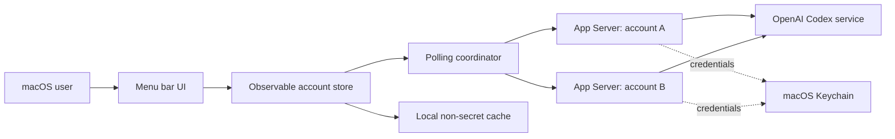

# System Design

## Overview

## Application shape

- Build a native SwiftUI application with an AppKit-compatible menu bar status item using `MenuBarExtra` in window style.
- Set `LSUIElement` so the app normally appears only in the menu bar.
- Provide a normal SwiftUI Settings scene, opened from the popover.
- Target macOS 14 or later and use Swift concurrency with `@MainActor` UI state.
- Locate a compatible Codex executable from the saved Settings path, `CODEX_EXECUTABLE`, an embedded executable, standard Homebrew locations, or the newest installed OpenAI VS Code extension. The selected path can be verified in Settings.

## Account isolation

Each account has a stable UUID and a dedicated directory beneath the app's Application Support directory. That directory acts as its `CODEX_HOME` and contains user-only non-secret configuration and runtime state.

Run one `codex app-server --stdio` child process per enabled account. Never use WebSocket listeners or expose a local network service. Initialize each process once and correlate JSON-RPC responses by request ID while independently handling notifications.

Set `cli_auth_credentials_store = "keyring"` for every profile. Startup must fail closed if Keychain storage is unavailable; it must not fall back to plaintext `auth.json`.

Removing an account asks its App Server to log out, stops the child process, removes the profile from persisted state, and deletes that account's local `CODEX_HOME`. Quitting the app stops processes but intentionally preserves profiles and Keychain sessions.

## Polling and lifecycle

- Poll `account/read` and `account/rateLimits/read` at the user's persisted interval, defaulting to five minutes, with bounded concurrency of three.
- Offer one-, five-, ten-, fifteen-, and thirty-minute intervals in Settings. Changing the preference cancels the old timer and schedules the next poll using the new interval.
- Refresh once when the menu bar content starts and support manual refresh from the popover.
- Apply a 15-second timeout to normal App Server requests and a 30-second timeout when starting browser login.
- One account failure never blocks another account.
- Stop child processes cleanly when accounts are disabled, removed, or the app quits.

Jitter, crash restart backoff, age-based stale transitions, reset-adjacent polling, and refresh-on-open age checks remain release-hardening work.

## Local persistence

Persist account labels, UUIDs, enabled state, masked identity hints, plan type, Codex executable path, refresh preference, and latest normalized snapshots. Do not persist access tokens, refresh tokens, API keys, authorization URLs, user codes, or raw protocol messages.

Use an atomic JSON file in Application Support for v1 metadata and cache. Add a schema version so future releases can migrate it safely.
